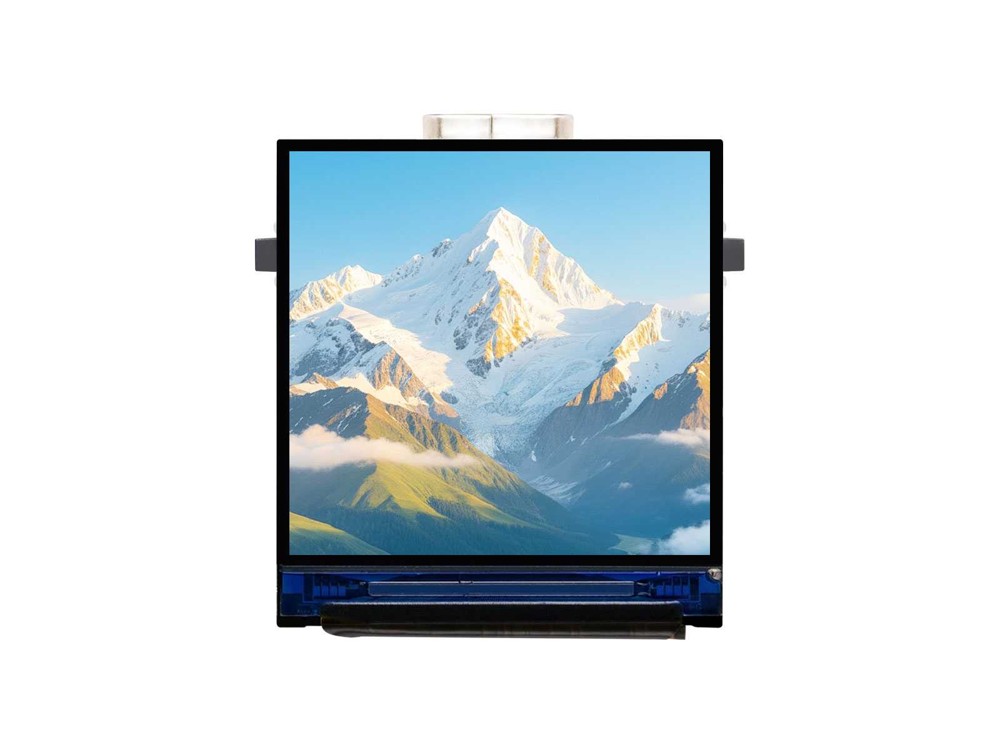

  <h1>ESP32-C6-LCD-1.3</h1>
  
<strong>ESP32-C6 development board with a 1.3-inch 240 × 240 LCD</strong>

  
<strong>English</strong> | <a href="README_ZH.md">简体中文</a>

  

    
    
  

  

    <a href="https://www.waveshare.com/esp32-c6-lcd-1.3.htm">🛒 Product</a> &middot;
    <a href="https://github.com/waveshareteam/ESP32-C6-LCD-1.3/tree/main/firmware">📦 Firmware</a> &middot;
    <a href="examples/esp-idf/">🧩 ESP-IDF</a> &middot;
    <a href="examples/arduino/examples/">🔧 Arduino</a> &middot;
    <a href="https://docs.waveshare.com/ESP32-C6-LCD-1.3/">📖 Documentation</a>
  

  

---

## ✨ Overview

The ESP32-C6FH4 board has a 1.3-inch LCD, an RGB LED, a microSD slot, and USB. This repository provides Arduino and ESP-IDF examples.

| Feature | Device or interface |
| --- | --- |
| MCU | ESP32-C6FH4 |
| Memory | 4 MB Flash, no PSRAM |
| Display | 1.3-inch IPS, 240 × 240, SPI, ST7789V2 |
| Peripherals | RGB LED, microSD, USB Type-C |

## 📦 Quick Start

1. Download the board test BIN from [firmware](https://github.com/waveshareteam/ESP32-C6-LCD-1.3/tree/main/firmware).
2. Connect the board over USB and follow the [official flashing instructions](https://docs.waveshare.com/ESP32-C6-LCD-1.3/Firmware-Flashing).
3. To build from source, follow one of the example guides below.

## 🧪 Examples

### ESP-IDF

| Example | Main feature |
| --- | --- |
| [ESP32-C6-LCD-1.3-Test](examples/esp-idf/ESP32-C6-LCD-1.3-Test/) | Show the board information and test the RGB LED |

### Arduino

| Example | Main feature |
| --- | --- |
| [LVGL_Arduino](examples/arduino/examples/LVGL_Arduino/) | Show the board information and test the RGB LED |
| [LVGL_WeatherClock](examples/arduino/examples/LVGL_WeatherClock/) | Show the time and weather over Wi-Fi |
| [Video_demo](examples/arduino/examples/Video_demo/) | Play an MJPEG file and display a PNG from a microSD card |

The bundled Arduino libraries are in [libraries](examples/arduino/libraries/).

## 🛠️ Development Environment

| Framework | Version | Examples |
| --- | --- | ---: |
| ESP-IDF | `v5.5.1` | 1 |
| Arduino-ESP32 | `3.0.1` | 3 |

## 📚 Resources

- [Schematic](hardware/schematic/)
- [Product page](https://www.waveshare.com/esp32-c6-lcd-1.3.htm)
- [Wiki](https://docs.waveshare.com/ESP32-C6-LCD-1.3/)

## 🤝 Support

- [Waveshare support](https://service.waveshare.com/)

## 📄 License

Bundled third-party code retains its respective license and copyright notices.
