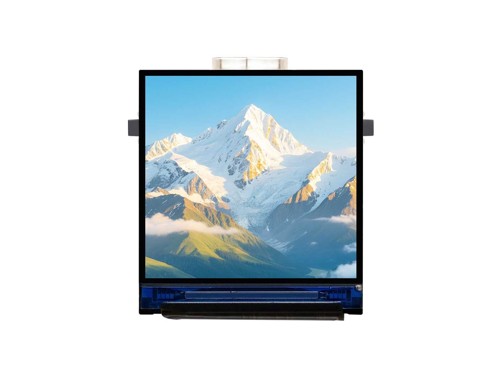

  <h1>ESP32-C6-LCD-1.3</h1>
  
<strong>ESP32-C6 1.3 英寸 240 × 240 LCD 开发板</strong>

  
<a href="README.md">English</a> | <strong>简体中文</strong>

  

    
    
  

  

    <a href="https://www.waveshare.com/esp32-c6-lcd-1.3.htm">🛒 产品</a> &middot;
    <a href="https://github.com/waveshareteam/ESP32-C6-LCD-1.3/tree/main/firmware">📦 固件</a> &middot;
    <a href="examples/esp-idf/">🧩 ESP-IDF</a> &middot;
    <a href="examples/arduino/examples/">🔧 Arduino</a> &middot;
    <a href="https://docs.waveshare.net/ESP32-C6-LCD-1.3/">📖 文档</a>
  

  

---

## ✨ 概述

这款开发板采用 ESP32-C6FH4，带有 1.3 英寸 LCD、RGB LED、microSD 卡槽和 USB 接口。本仓库提供 Arduino 和 ESP-IDF 示例。

| 功能 | 器件或接口 |
| --- | --- |
| MCU | ESP32-C6FH4 |
| 存储器 | 4 MB Flash，无 PSRAM |
| 显示 | 1.3 英寸 IPS，240 × 240，SPI，ST7789V2 |
| 扩展 | RGB LED、microSD、USB Type-C |

## 📦 快速开始

1. 从 [firmware](https://github.com/waveshareteam/ESP32-C6-LCD-1.3/tree/main/firmware) 下载板载功能测试 BIN。
2. 使用 USB 连接开发板，按[官方烧录步骤](https://docs.waveshare.com/ESP32-C6-LCD-1.3/Firmware-Flashing)写入。
3. 如需从源码构建，打开下面的对应示例说明。

## 🧪 示例

### ESP-IDF

| 示例 | 主要功能 |
| --- | --- |
| [ESP32-C6-LCD-1.3-Test](examples/esp-idf/ESP32-C6-LCD-1.3-Test/README_ZH.md) | 显示板上信息并测试 RGB LED |

### Arduino

| 示例 | 主要功能 |
| --- | --- |
| [LVGL_Arduino](examples/arduino/examples/LVGL_Arduino/README_ZH.md) | 显示板上信息并测试 RGB LED |
| [LVGL_WeatherClock](examples/arduino/examples/LVGL_WeatherClock/README_ZH.md) | 通过 Wi-Fi 显示时间和天气 |
| [Video_demo](examples/arduino/examples/Video_demo/README_ZH.md) | 播放 microSD 卡里的 MJPEG，并显示 PNG |

配套 Arduino 库位于 [libraries](examples/arduino/libraries/)。

## 🛠️ 开发环境

| 开发框架 | 版本 | 示例数 |
| --- | --- | ---: |
| ESP-IDF | `v5.5.1` | 1 |
| Arduino-ESP32 | `3.0.1` | 3 |

## 📚 资料

- [原理图](hardware/schematic/)
- [产品页](https://www.waveshare.com/esp32-c6-lcd-1.3.htm)
- [Wiki](https://docs.waveshare.net/ESP32-C6-LCD-1.3/)

## 🤝 支持

- [微雪技术支持](https://docs.waveshare.net/ESP32-C6-LCD-1.3/Technical-Support/)

## 📄 许可证

随附的第三方代码适用各自的许可证和版权声明。
